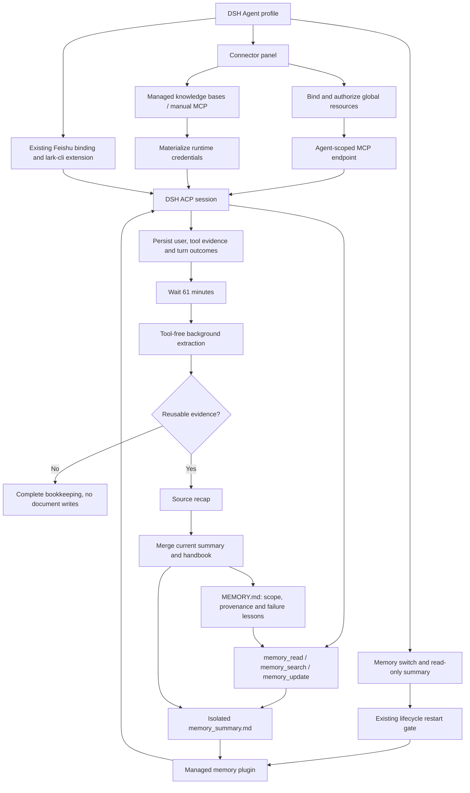

# DSH Agent resources

Chinese companion: [dsh-resources.zh.md](dsh-resources.zh.md).

DSH Agents use the same connector panel as Codex: bind a global resource, authorize it, inspect its tools, enable or disable it, or remove the binding. Manual MCP servers and managed knowledge bases stay available in that panel. The existing Agent MCP endpoint supplies connector tools using an Agent-scoped credential. Knowledge-base credentials are materialized at launch and are not written back to the Agent configuration. A connector catalog refresh restarts an idle ACP process and resumes its existing sessions; active work finishes before refresh.

## Durable memory

DSH implements the runtime-neutral `MemoryController`. Its existing profile memory tab displays a read-only summary and controls `runtime_options.memory_mode` (`enabled` by default, or `disabled`). The lifecycle controller applies a change through the existing restart gate.

The managed ACP plugin contributes `memory_read`, `memory_search`, `memory_update`, and a concise summary to model context. `memory_read` defaults to the summary; `document: "handbook"` reads the detailed handbook. Search returns bounded keyword matches from the current summary and handbook. Root conversations enter independent background extraction and consolidation without requiring the main Agent to call a memory tool. Models still choose which facts are durable.

Timing matches CSGClaw's Codex App Server integration: capture the first ended turn containing direct user input immediately, then at most one snapshot per conversation per hour. Failed and interrupted outcomes are retained as evidence; injected-only turns are excluded. Subsequent turns are persisted and promoted at the next hourly boundary even if chatting stops. Each snapshot becomes eligible 61 minutes after capture; continued chatting does not postpone it. A tool-free request extracts durable facts, then another merges the current summary and handbook. Later turns may wait the remaining checkpoint interval plus 61 minutes; provider latency and failures can delay completion.

Snapshots and pending work are saved immediately in `$DSH_HOME/memories/maintenance.json`, with at most 16 pending snapshots and 16 buffered conversations. DSH 0.1.5-rc.3's public `snapshotEvents()` supplies direct user text, visible assistant text, tool calls/results, and turn outcomes with event references, session IDs and workspace provenance. Individual tool outputs are capped at 4 KiB; total transcript size is capped at 32 KiB while retaining the latest user constraint. Subagents, injected context, system prompts, reasoning, tool-private metadata, and memory tools' own calls/results are excluded. Credential formats, private keys, JWTs and the configured model credential are redacted before persistence and in generated fields. JSON arguments/results are parsed to redact credential fields and escaped strings; embedded JSON is handled too, while ambiguous escaped credential fragments are hidden completely. Older pending evidence is sanitized on load and inputs are sanitized again before auxiliary model dispatch.

Useful extractions receive timestamped source records under `rollout_summaries/`. Low-signal extractions complete bookkeeping without writing evidence, summary or handbook files. Auxiliary requests have no tools and never enter the main Agent loop. Each request has a two-minute deadline; failed work retries after five minutes, reusing extraction from the same policy version. Older queued extractions are regenerated under the new policy before consolidation. Restart restores original due times and uses the Agent's current model. An unreadable queue is preserved and disables background work with a warning; ordinary conversation and memory tools remain available.

The short summary lives at `$DSH_HOME/memories/memory_summary.md` (32 KiB) and the detailed handbook at `MEMORY.md` (64 KiB), outside the selected project. Consolidation validates both responses and revisions before atomic replacement of each individual file, retrying after revision conflicts. The summary holds actionable preferences and navigation; the handbook holds scoped facts, sources, validated procedures and failure lessons.

The existing `memory_update` arguments (`content`, `expected_revision`) remain supported and replace both current documents with approved content. Optional paired `handbook` / `expected_handbook_revision` arguments maintain details separately from the summary. Successful explicit updates invalidate older snapshots and advance each discarded buffer's capture cursor without changing checkpoint timing. The boundary survives restart so another conversation cannot recapture the discarded preference when it resumes. Forgetting must remove facts from both layers; search excludes historical evidence so archived facts cannot reappear through automatic retrieval. Symlink paths are rejected. Maintenance writes only managed memory, including in read-only workspace mode.

## Extraction rules and Codex comparison

Rules are informed by the Codex 0.149.1 extraction/consolidation prompts used by CSGClaw, reimplemented against DSH's APIs rather than calling Codex:

- Apply a minimum-signal gate: only information that plausibly improves future behavior; skip greetings, routine updates, temporary metrics, common knowledge and unchanged baseline behavior.
- Prefer user evidence for preferences and tool/test evidence for technical facts. Assistant claims, proposals and brainstorming are not verification.
- Preserve scope, attribution and uncertainty. A one-time instruction not to create a PR is not a permanent preference. Repeated steering is stronger evidence; explicit lasting instructions may be saved once with their applicability.
- Classify tasks as success / partial / fail / uncertain. A completed turn alone does not establish task success.
- Preserve reusable failure lessons: symptom, known cause, attempted fix, actual verification, and stop/pivot conditions. Unverified fixes remain unverified.
- Deduplicate without losing scope or provenance; apply explicit correction/forgetting to both documents. Conflicting evidence without a correction retains scope and uncertainty rather than preferring a newer assistant claim.
- Inject the short summary; retrieve the richer handbook on demand; source recaps support provenance.

Memory remains Agent-scoped. Automatic executable skill generation, Codex's global eviction/use counters, and identical model-selected contents are not implemented.

Disabling memory removes its tools, new context contributions, capture and background work; stored summaries and pending work remain for re-enabling. Existing conversation history is retained, so previously injected memory is not erased. Recreating an Agent preserves the memory directory. A template may include only the summary, without snapshots or pending work, when memory is enabled and the user explicitly selects **Include agent memory**. Creating from that template seeds the new Agent's isolated memory; it does not copy memory into the project or overwrite an existing learned summary.

## Resource flow



## Verification

`GOWORK=off go test ./...` runs the shared integration and lifecycle suite. Native ACP cases use an isolated DSH installation and deterministic local model/MCP servers; no production model or Feishu account is required:

```sh
GOWORK=off CSGCLAW_TEST_DSH_BINARY=/absolute/path/to/dsh go test ./internal/runtime/dsh -run 'TestResourcesNativeDSHE2E|TestMemoryNativeDSHE2E|TestBackgroundMemoryNativeDSHE2E|TestSkillEnablementNativeDSHE2E' -count=1
```

The native DSH `0.1.5-rc.3` cases verify connector and knowledge-base calls, scoped credentials, catalog refresh without session loss, memory and skill projection. Background E2E uses accelerated timing and deterministic model/MCP servers to verify tool evidence capture, automatic summary and handbook creation, recovery, disable/re-enable, and reading details in a new conversation. Virtual-clock cases cover cadence, retries, both revisions, forgetting, no-signal document no-ops, failed outcomes, bounded evidence and old-policy migration. These tests verify data, transport and lifecycle, not real-model semantic compliance or fact selection. A live Feishu round trip remains a deployment acceptance check.
