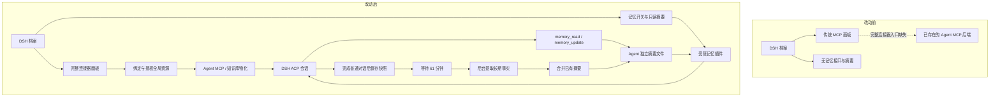
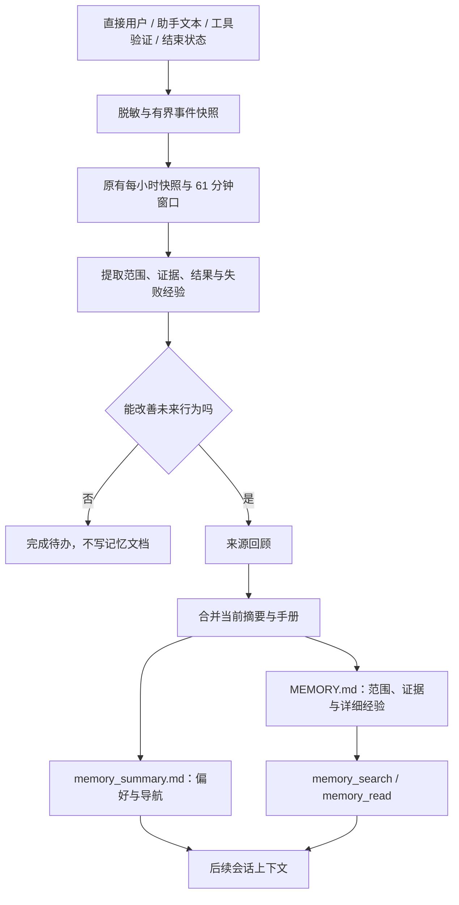

# DSH 资源接入与改动说明

英文说明见 [dsh-resources.md](dsh-resources.md)。

改动位于 CSGClaw 的 Web UI、DSH Runtime 和模板集成层。DSH 的连接器、知识库与飞书通道底层链路已经存在；本次补齐完整连接器入口和持久记忆，并验证原有链路。无需修改 DeepSeek Harness 或 OpenClaw 插件仓库。

## 改动前后

| 能力 | 改动前 | 改动后 |
| --- | --- | --- |
| 连接器 | 后端已接入，DSH 页面只展示传统 MCP 管理入口 | 与 Codex 共用完整连接器面板，支持全局资源绑定、授权、工具查看、启停与解绑 |
| 知识库 | 已支持运行时 MCP 物化 | 保留原链路；真实 DSH 测试确认工具发现、授权和结果回传 |
| 记忆 | 未实现 MemoryController，没有记忆面板与持久摘要 | 支持开关、只读摘要、跨会话读取、即时工具更新、后台提取合并、重建保留 |
| 模板记忆 | DSH 模板不携带摘要 | 启用记忆且明确勾选时携带；创建新 Agent 时写入其独立目录 |
| 技能与飞书 | 已有启停投影、通道绑定和 lark-cli 扩展 | 保留原链路，验证相关回归测试 |

## 记忆如何工作

默认启用 `runtime_options.memory_mode=enabled`。插件将短摘要作为上下文交给模型，并提供 `memory_read`、`memory_search` 和 `memory_update`。`memory_read` 默认读取摘要，传入 `document=handbook` 读取详细手册；`memory_search` 按关键词检索当前摘要与手册，返回有长度限制的片段。普通聊天会自动进入独立的后台提取与合并流程，不要求主会话调用记忆工具；记住哪些事实仍由模型选择。

后台触发时间对齐 CSGClaw 的 Codex App Server 接入：每个会话第一轮含直接用户输入的回合结束时立即保存快照，此后最多每小时创建一次。失败、中断等结束状态也保留，供提取器判断失败经验；仅有插件注入的回合不采集。间隔内的新回合也立即持久化，到下一个小时边界自动生成后续快照，即使用户已经停止聊天。每份快照从创建时等待 61 分钟，然后通过 DSH 已配置的模型提取长期事实，再合并当前摘要和手册。继续聊天不会推迟已保存快照的时间。第一份约 61 分钟后开始处理；间隔内的新内容可能需等待剩余快照间隔再加 61 分钟。摘要还需等待模型请求完成。

快照与待办状态立即存入 `$DSH_HOME/memories/maintenance.json`，队列最多 16 份，间隔内另保留最多 16 个会话的后续内容。使用 DSH `0.1.5-rc.3` 的公开 `snapshotEvents()` 接口采集直接用户文本、助手可见文本、工具名称/参数/结果与回合结束状态，保留事件序号、会话和工作目录来源。工具输出单条限制为 4 KiB，整份快照限制为 32 KiB，超限时保留最新用户约束并截断证据；不采集子智能体、系统提示、思考过程、工具私有元数据或插件注入。记忆工具自身的调用和结果也排除，避免回读旧记忆成为新的验证证据。常见凭据、私钥、JWT 及当前模型凭据在持久化和生成结果中脱敏。JSON 参数/结果先解析字段与转义字符串，按凭据键脱敏；嵌在文本里的 JSON 也处理，无法可靠解码的转义凭据片段整体隐藏。旧待办在加载时重新脱敏，发送后台模型前再次脱敏。

提取成功且有可复用事实时，`rollout_summaries/` 保存带时间、会话、工作目录的证据回顾。低信号内容不写回顾、摘要或手册，只完成待办。已保存待办使用当前智能体的模型；旧规则已经提取但尚未合并的待办会按新规则重新提取。队列文件损坏时保留原文件、暂停后台生成并记录警告，不中断普通聊天。后台请求没有工具权限，不进入主智能体执行循环，不阻塞后续聊天。单次请求超时为 2 分钟，失败保留快照并在 5 分钟后重试；同一规则版本的成功提取可复用。正常重启后恢复待办及原有到期时间。

短摘要存放于 `$DSH_HOME/memories/memory_summary.md`（32 KiB），详细手册存放于同目录的 `MEMORY.md`（64 KiB）。后台合并先校验两份输出的类型、大小和旧版本，再逐文件原子替换；版本变化时重新读取后重试。摘要提供偏好与导航，手册按任务/项目保存适用范围、来源、验证方法和失败经验。

即时 `memory_update` 保留原有 `content` / `expected_revision` 接口；只传这两个字段时，两份当前文档均替换为批准的内容。也可以同时传入 `handbook` / `expected_handbook_revision`，单独维护短摘要和详细手册。成功更新取消更早的待办快照，并将各会话的采集游标推进到被丢弃缓冲的末尾；原快照时间保持不变。该边界持久化后，另一会话即使重启后继续聊天，也不会重读已丢弃的偏好。忘记请求需从两层同时移除事实。搜索只读取当前文档，历史证据保留为档案，避免忘记的事实从历史搜索中再次进入上下文。受管记忆仅写智能体自己的 `memories/` 目录，在工作目录只读模式下也可使用。

## 抽取规则与 Codex 的对应关系

规则参考 CSGClaw 当前 Codex `0.149.1` 的抽取与合并提示词，并按 DSH 的工具和文件契约重新实现；不是调用 Codex，也不保证不同模型生成相同内容。

| 规则 | DSH 行为 |
| --- | --- |
| 最低保存门槛 | 判断是否有助于未来行为；问候、普通进度、临时指标、常识和未改变的基线不保存 |
| 证据优先级 | 偏好以用户陈述和纠正为主，技术事实以工具/测试结果为主；助手的计划和断言不能代替验证 |
| 偏好适用范围 | 区分本回合、本任务、本项目和通用默认；“这次不建 PR”不能变成永久禁止 |
| 稳定性 | 重复纠正是较强信号；明确的长期指令可以一次保存，保留来源与范围；不从孤立对话推断人格或身份 |
| 任务结果 | 分为 success / partial / fail / uncertain；回合正常结束不等于任务成功 |
| 失败经验 | 保存症状、已知原因、修复尝试、实际验证与停止/转向条件；未验证的方法继续标为未验证 |
| 合并与纠正 | 保留有效旧事实、去重、保持适用范围与来源；明确纠正/忘记优先，不能用较新的助手猜测覆盖用户事实 |
| 分层读取 | 短摘要常驻上下文，详细手册按需检索，回顾用于追溯来源 |

没有照搬 Codex 的全部能力：仍按 Agent 隔离，未自动生成可执行 skills，也未实现 Codex 的全局记忆淘汰与使用计数机制。

关闭后，插件不再提供记忆工具、新的记忆上下文、快照采集或后台处理；摘要及待办仍保留，再次启用后恢复。已有会话历史中已经出现的记忆内容不会被删除。重建保留整个记忆目录。发布模板时，只有启用记忆并主动勾选“包含智能体记忆”才会带出摘要，不携带会话快照与待办；从模板创建时写入新 Agent 的独立目录，重建不会用模板摘要覆盖已经学到的内容。

| 本次补齐 | 修改前的 DSH | 修改后的 DSH |
| --- | --- | --- |
| 生成触发 | 主会话模型调用记忆工具 | 保留即时工具更新，并自动保存普通聊天快照 |
| 后台处理时间 | 没有独立后台处理 | 对齐 Codex 的每小时快照节奏与 61 分钟等待窗口 |
| 提取与整理 | 模型直接修改摘要 | 独立、无工具的模型请求先筛选有证据的长期信息，再合并摘要和手册 |
| 证据与失败经验 | 聊天文本、泛化规则 | 采集工具验证和失败状态，明确来源、范围与任务结果 |
| 分层与检索 | 单份摘要 | 常驻短摘要、详细手册、来源回顾；按需读取和检索当前记忆 |
| 失败与重启 | 无后台待办 | 持久化待办、保留原到期时间、失败重试 |

## 验证边界

真实 DSH `0.1.5-rc.3` ACP 配合本地确定性模型和 MCP 服务验证连接器、知识库、授权、目录刷新保留会话、记忆更新与启停、技能启停。后台记忆端到端用加速时间验证 MCP 工具结果进入抽取快照、主会话无需调用记忆工具仍可生成两层记忆、关闭期间不处理、重启恢复待办，以及新会话读取摘要和详细手册。虚拟时钟测试验证节奏、重试、两层版本冲突、遗忘、无信号不写文件、失败证据、截断边界及旧规则待办迁移。确定性模型验证数据和调度链路，不证明真实模型一定遵守语义筛选或选择某条事实。飞书绑定、权限确认、lark-cli 扩展与消息投递通过现有测试验证；本次未使用真实飞书账号进行外部对话验收。
