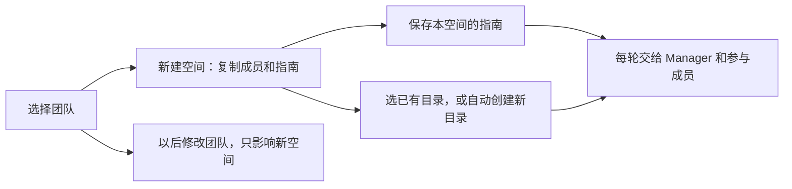

# 房间共享目录与团队协作指南

对应 #3992 / #4093。团队保存可复用的规则；每个协作空间保存自己的指南和文件目录。

按 10 月 27 日会议方向落实：**建空间时复制，之后各自独立。** 会议没有最终确定所有边界，下表是本分支可演示、可测试的实现选择，供产品和测试确认。

| 操作或疑问 | 本分支行为 |
| --- | --- |
| 在哪里写指南？ | 团队详情的「协作指南」；已有空间内可展开查看当时保存的内容。 |
| 谁收到？ | Manager 与实际参与执行的成员；不写入智能体个人指令文件，不传入私聊或其他空间。 |
| 何时收到？ | 创建时保存；每轮执行都附上这份原指南，包括重启、重置和历史压缩后的下一轮。 |
| 会覆盖 Manager 的分工逻辑吗？ | 不会；它补充工作要求，不能覆盖原有任务分工、成员范围和工具权限。 |
| 修改或删除原团队？ | 旧空间的指南、成员和目录不变；新空间读取创建时的团队内容。 |
| 在空间里增删成员？ | 只改变该空间；新成员执行时收到同一份指南和目录，被移除成员不能领取后续任务。 |
| 在空间里直接改指南？ | 本期只读；需要新规则时，修改团队并新建空间。 |
| 不选目录？ | 页面显示「自动创建共享目录」，服务端分配 `workspaces/<room-id>`；不会默认使用 Manager 私人目录。 |
| 选已有目录？ | 使用 CSGClaw Server 上的绝对路径，创建后锁定；模型、权限仍由各成员自己的配置决定。 |
| 旧房间和删会话？ | 没有共享目录的旧房间继续用成员目录；删除会话保留文件。 |

## 接口与代码

- `POST/PATCH /api/v1/teams`：`collaboration_guide`；PATCH 空字符串清空，省略则保留。对应 `internal/team`、团队 API、`TeamDetailPane`。
- `POST /api/v1/rooms`：前端提交成员、`source_team_id` 和 `configuration.workspace_dir`；后端按团队 ID 取指南。对应 `collaboration_configuration.go`、`im/service.go`、`room_workspace.go`。
- 创建重试：同一个 `client_request_id` 只能对应原团队和原目录选择；相同请求返回原空间，即使团队指南已改或团队已删。前端改团队或目录时换新请求 ID。
- 执行：`room_task_context.go` 读取空间副本，`roomtask/context_projection.go` 每轮携带指南；`task context --room <id>` 可查询当前空间规则。指南作为用户工作要求传入，不能伪装成服务端指令。
- 文件 API：带 `room_id` 校验成员后，列表、预览、下载和引用都使用空间目录；旧房间无共享目录时沿用成员目录。

## 验收与范围

1. 团队写规则 A，建空间一；改规则 B、换团队成员，再建空间二：两个空间分别保留各自的成员、指南和目录。
2. 空间一继续聊、重启或重置后，Manager 和执行成员仍收到 A；私聊和空间二不带入 A。
3. 空间一加成员：新成员收到 A、可读共享文件；移除后不能再执行该空间任务。其他空间不变。
4. 创建响应丢失后重试，不重复建空间；改团队或目录后，不误返回旧空间。
5. 自动目录与手选目录的显示、执行和文件预览一致；旧房间的原文件仍可读取。

本次自动化验证覆盖服务端上下文、目录和页面交互，不代表真实模型一定遵守指南。原生 Codex / DSH 已有按房间切目录能力；**OpenClaw / PicoClaw 容器仍需部署侧提供共享挂载，尚未验收。** 本期不新增团队模板、自然语言建团队或云端存储迁移，也不提供并发编辑同一文件的冲突处理。

若旧测试版本已经给历史房间写入自动目录，本次保留该配置和文件，不自动推测并撤销；需核对原目录后单独恢复。
